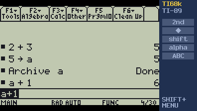
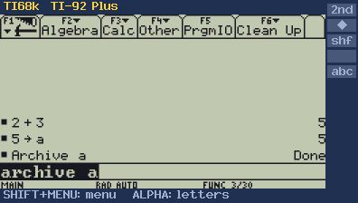
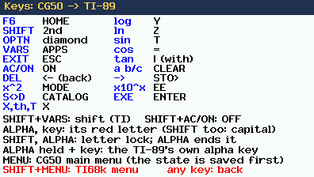
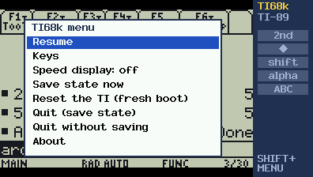

# TI68k

TI68k is a TI-89 / TI-92 Plus emulator for the Casio fx-CG50. It runs the TI's own operating
system (AMS) from a ROM dump of your own calculator: the home screen, the computer algebra
system, graphs, programs, VAR-LINK, the archive, everything the real calculator does.



*A TI-89 at twice its size. The panel on the right lights up 2nd, ♦, shift and alpha as the TI
sees them.*



*A TI-92 Plus, scaled by 1.5 to fit the wider screen.*

TI68k contains no TI software. You need a ROM dump of a TI-89 or TI-92 Plus that you own.

## Features

- Runs AMS on an emulated TI-89 or TI-92 Plus; the model is detected from the ROM.
- The TI's keys on the CG50 keyboard, with the CG50's red letters typing letters.
- Everything is kept: the TI's memory and archive are saved when you leave and restored when you
  come back, so variables, programs and settings survive like on a real calculator.
- MENU goes to the CG50's main menu and TI68k picks up where you were when you open it again.
- Turning the TI off (2nd ON, or after a few idle minutes) really idles the CG50.
- An emulator menu (SHIFT+MENU) with the key list, a speed display, saving, reset and quit.

## Install

1. Download `TI68k.g3a` from the [Releases](../../releases) page.
2. Connect the fx-CG50 by USB and choose USB Flash (F1) on the calculator.
3. Copy `TI68k.g3a` to the root of the calculator's storage memory.
4. Copy your ROM dump to the calculator too. Any name and any folder will do, as long as the
   name uses plain letters, digits and punctuation and the folder plus name stay under 47
   characters.
5. Disconnect, then open **TI68k** from the main menu.

At the first start TI68k shows the files in the storage memory: choose your ROM dump (2 MB
files are marked; EXE opens a folder, EXIT goes back) and the TI boots from scratch, which takes
a few seconds. TI68k remembers the choice. To switch, for example between a TI-89 and a TI-92
Plus, use **Choose another ROM** in the TI68k menu: each ROM keeps its own saved state.

### Getting a ROM

A ROM dump is a copy of your own calculator's flash memory. Make one with
[TiLP](http://lpg.ticalc.org/prj_tilp/) and a link cable: connect the TI, and use TiLP's ROM
dump function. The result is a 2 MB file; a dump made with TiEmu works too.

Tested with AMS 2.09 on a TI-89 (hardware 2) and a TI-92 Plus. Other AMS versions should run;
the side panel's 2nd / ♦ / shift / alpha lights are known for AMS 2.09 only. Hardware 1 ROMs
are untested. The TI-89 Titanium and Voyage 200 are not supported.

## Keys



| CG50 | TI-89 | | CG50 | TI-89 |
|---|---|---|---|---|
| F1–F5 | F1–F5 | | EXE | ENTER |
| F6 | HOME | | DEL | ← (backspace) |
| SHIFT | 2nd | | a b/c | CLEAR |
| OPTN | ♦ | | → | STO▶ |
| VARS | APPS | | ×10ˣ | EE |
| EXIT | ESC | | x² | MODE |
| AC/ON | ON | | S⇔D | CATALOG |
| X,θ,T | X | | log / ln / sin | Y / Z / T |
| SHIFT, VARS | ⇧ (shift) | | cos / tan | = / \| |

Digits, operators, brackets, the comma, `^`, (−) and the arrows are the same keys.

- **ALPHA, then a key** types the red letter printed above that key. SHIFT, ALPHA locks letters
  until the next ALPHA; SHIFT with a letter types a capital.
- **ALPHA held** with a key is the TI-89's own alpha key, for games that use it.
- **SHIFT+AC/ON** turns the TI off.
- **MENU** goes to the CG50's main menu (the TI's state is saved first).
- **SHIFT+MENU** opens the TI68k menu; its **Keys** page shows this list on the calculator.

On a TI-92 Plus the layout is the same, except S⇔D = F7, log = F8, ×10ˣ = `=`, SHIFT+OPTN =
HAND, and ln, sin, cos, tan are themselves. Letters are typed through the ALPHA layer.

## The TI68k menu



SHIFT+MENU: Resume, Keys, Speed display on/off, Save state now, Choose another ROM, Reset the TI
(a fresh boot), Quit (saving the state), Quit without saving, About.

The state is saved next to the ROM, with `.sav` in place of its extension (`my89.bin` gets
`my89.sav`). The chosen ROM is remembered in `TI68k.cfg`. A damaged state file is
detected at start; TI68k then asks before starting fresh.

## Speed

Typing, menus, the home screen and most everyday work run at full speed. Long computations (big
symbolic results, slow graphs, heavy programs) run at about 60 % of a real TI-89 on an fx-CG50.
A faster 68000 core written for the CG50 is the next step.

Like on a real TI, the BUSY indicator appears for a moment on most keystrokes; the TI's slow LCD
usually hides it, the CG50's sharper screen sometimes shows it.

## Not done yet

- Sending files (`.89p`, `.9xp` and others) to the emulated TI.
- Grayscale: games that flip between two pictures to make grey will flicker.
- The TI's clock doesn't move on while TI68k isn't running.
- 2nd+APPS (SWITCH) has no CG50 key.

## Building

TI68k is built with the [fxSDK](https://git.planet-casio.com/Lephenixnoir/fxsdk) and
[gint](https://git.planet-casio.com/Lephenixnoir/gint):

```
cd app
python3 prepare.py
fxsdk build-cg
```

`prepare.py` fetches [Musashi](https://github.com/kstenerud/Musashi) (the 68000 core, at the
tested commit) into `third_party/`, generates its opcode tables and writes `app/gen/`. The result
is `TI68k.g3a`.

`python3 prepare.py --embed-rom ROMFILE` builds `TI68Krom.g3a` with the ROM inside, so no ROM
file is needed on the calculator. It contains TI's software: keep it for your own calculator and
never share it.

Other folders: `bench/` holds the machine (`ti68k.c`) and desktop tools for testing it against
a ROM (`tibench`, `tiexp`, built with `bench/build.sh`); `addin/` is TIbench, a speed test that
runs the same core on the calculator.

## Credits

- [Musashi](https://github.com/kstenerud/Musashi) by Karl Stenerud: the 68000 core (MIT).
- [gint](https://git.planet-casio.com/Lephenixnoir/gint) and the fxSDK by Lephenixnoir.
- The TI-89 / TI-92 Plus hardware is described by the TIGCC / GCC4TI documentation, TiEmu and
  MAME's ti89 driver, which this emulator's machine was written from.

## Licence

GPL-3.0-or-later (see `LICENSE`). Musashi keeps its MIT licence.

TI68k is not affiliated with Texas Instruments. TI-89, TI-92 Plus and AMS are TI's.
